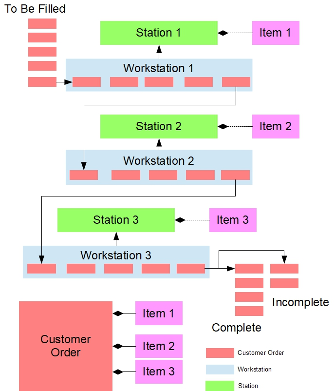

# Assembly Line Simulator

A C++17 console simulator that moves customer orders through a configurable chain of workstations. Each station manages its own inventory, fills matching items, and forwards orders until they are classified as complete or incomplete.



## Features

- Load inventory, customer orders, and station connections from text files.
- Reconstruct the processing order from station-to-station links rather than relying on input file order.
- Process orders through FIFO queues and assign item serial numbers as inventory is consumed.
- Forward orders when the current station has filled its items or exhausted its stock.
- Report processing iterations, completed orders, incomplete orders, and remaining inventory.

## Technology

C++17, the C++ standard library (`vector`, `deque`, algorithms, streams, and move semantics), and Visual Studio C++ project files. The console application also builds with GCC without third-party libraries.

## Design

| Component | Responsibility |
| --- | --- |
| `Utilities` | Parse delimited records and maintain token display width. |
| `Station` | Manage an inventory item, its quantity, description, and serial numbers. |
| `CustomerOrder` | Own requested items and track their fulfillment state. |
| `Workstation` | Extend `Station` with an order queue and a link to the next station. |
| `LineManager` | Connect and order stations, admit pending orders, and advance the simulation. |

Orders transfer between queues with `std::move`. Copy assignment is disabled and the copy constructor rejects copying, keeping ownership of dynamically allocated order items with one order object. Workstation links are non-owning pointers; the console driver creates and deletes the station objects.

Each iteration admits at most one pending order, attempts to fill the front order at every active station, and then advances eligible orders. Completed and incomplete orders are collected separately. This is a single-threaded simulation using shared pending, completed, and incomplete queues.

## Build and run

From the repository root, with a C++17-capable GCC compiler on your PATH:

```sh
g++ -std=c++17 -Wall -Wextra src/CustomerOrder.cpp src/LineManager.cpp src/Station.cpp src/Utilities.cpp src/Workstation.cpp src/tester_3.cpp -o assembly-line-sim.exe
```

On Windows PowerShell:

```powershell
.\assembly-line-sim.exe files/Stations1.txt files/Stations2.txt files/CustomerOrders.txt files/AssemblyLine.txt
```

On Linux or macOS, run the same command with `./assembly-line-sim.exe` instead of `.\assembly-line-sim.exe`.

The four arguments are required in this order:

1. Comma-delimited station inventory (`Stations1.txt`).
2. Pipe-delimited station inventory (`Stations2.txt`).
3. Customer orders (`CustomerOrders.txt`).
4. Station connections (`AssemblyLine.txt`).

Example record formats:

```text
Station: ItemName|SerialNumber|Quantity|Description
Order:   CustomerName|ProductName|ItemName|ItemName
Link:    StationName|NextStationName
```

The final station's link record contains only its own name. Keep station names consistent between inventory and connection files.

For Visual Studio, open `WS04.sln` with the Desktop development with C++ workload and the v143 toolset (or retarget the project). The project selects `tester_3.cpp` as the entry point. In the startup project's Debugging settings, use `$(ProjectDir)` as the working directory and the four paths above as command arguments.

## Validation

`tester_1.cpp`, `tester_2.cpp`, and `tester_3.cpp` exercise parsing/inventory, order handling, and the full assembly line respectively. Build each driver separately: they each define `main`, so do not compile all three together. Reference outputs are included in `files/`.

The full simulation has been compiled with GCC using C++17 and run against the bundled inputs. It produces completed and incomplete order reports and an inventory summary. This check does not establish exhaustive correctness or memory-leak freedom.

## Repository layout

```text
src/                 Simulator classes and console validation drivers
files/               Inventory, orders, station links, and reference output
WS04.sln             Visual Studio solution
assemblyline.jpg     Assembly line illustration
```

## Credits

Implementation: **Tianwen Wang (MaxTianwen)**. The supplied validation drivers, sample inputs, and reference material originate from Seneca Polytechnic's OOP345 materials. Existing source identifiers and attribution are retained; this repository does not claim sole authorship of supplied material.
